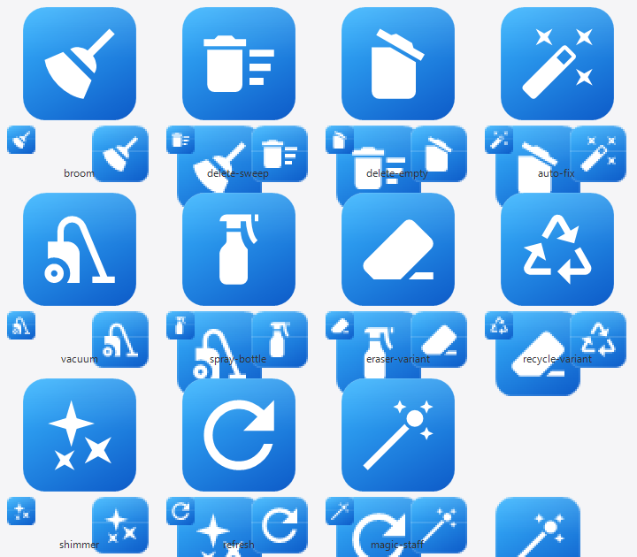

# CleanC · Windows C 盘清理工具

**扫描 C 盘，按风险分级列出能清什么，只删你勾选的。**

PowerShell + WinForms 写的单文件小工具，不装服务、不驻留后台、不改注册表。
整个界面就是一个清单：每一项是什么、多大、删了会怎样，都写在上面。

<br clear="left">

---

## 它和"一键清理"软件的区别

大部分清理软件只有一个按钮，点完你不知道它删了什么。
这个反过来：**先扫描、列清楚，再让你决定。**

| 风险 | 颜色 | 行为 |
|---|---|---|
| 安全 | 🟢 绿 | 零风险，默认已勾选（缓存、临时文件、回收站这类会自动重建的） |
| 注意 | 🟡 黄 | 是真东西但能重建，默认**不**勾，你自己判断 |
| 勿动 | ⚪ 灰 | 根本不让勾，鼠标停上去有"说明"列写明为什么不能删 |

灰色那档是这个工具的重点 —— 它把几个"看着像缓存、其实是命根子"的目录专门列出来
（比如某些 AI 工具的运行时目录、`C:\Windows\Installer`），
省得你或者别的清理软件把它们当垃圾干掉。

它**不会**做的事：

- 不会删任何你没勾的东西
- 不碰注册表、不卸载软件、不改系统设置
- 不联网、不上报、没有后台进程

## 下载

到 [Releases](../../releases) 页面下载最新的 `C盘清理工具.exe`，双击运行即可。
**单文件，不需要安装任何东西。**

> 前提：Windows 7 及以上（Win10/11 自带 PowerShell 5.1，无需另装），需要管理员权限
> —— 程序会自己弹 UAC 提权。

### 第一次打开可能被拦

1. **SmartScreen**：这个 exe 没有数字签名，从浏览器/聊天软件下载后 Windows 会提示
   "Windows 已保护你的电脑"。点 **更多信息 → 仍要运行**。
2. **杀毒软件**：用 ps2exe 打包的 exe 容易被误报（卡巴斯基 / 360 / 管家都有先例），
   可能直接被删除或隔离。请加白名单，**不要**为了这个关掉杀毒软件。

## 怎么用

1. 双击运行，UAC 点"是"。
2. 点 **扫描**，等进度条跑完。
3. 看清单，勾选要清的。懒得挑就点 **一键清理安全项**（只勾绿色的，走的还是同一套确认流程）。
4. 点 **清理选中项** → 弹确认框，看清楚要删什么 → 确认。
5. 结束后按 **C 盘剩余空间的实际变化**统计结果，不是把文件大小加起来糊弄你。

其他按钮：

- **导出 CSV** —— 把扫描结果存成 CSV，中文表头用 UTF-8 BOM，Excel 直接打开不乱码
- **只选安全项 / 全不选** —— 快速调整勾选
- **显示禁止删除项** —— 控制灰色那档要不要露出来（默认显示）

每次运行会在 exe 所在目录追加 `CleanC.log`。如果 exe 放在只读位置（共享盘、写保护的
U 盘），日志自动退到 `%TEMP%\CleanC.log`。

## 从源码构建

```powershell
# 需要 PowerShell 5.1 + ps2exe 模块
Install-Module ps2exe -Scope CurrentUser
powershell -NoProfile -ExecutionPolicy Bypass -File src\build-exe.ps1
```

产物 `C盘清理工具.exe` 落在仓库根目录，用 `-RequireAdmin -NoConsole -STA` 打包
（`-STA` 是 WinForms 的硬要求）。

**改源码时注意**：`CleanC.ps1` 里的中文必须存成 **UTF-8 带 BOM**。
PowerShell 5.1 会把没有 BOM 的 UTF-8 `.ps1` 当成 ANSI 读，中文全变乱码。
`build-exe.ps1` 会自动补 BOM，但你新建别的带中文的脚本时要自己记得。

## 换图标

图标是 Material Design Icons 的字形，用 GDI+ 渲染成 9 个尺寸（16～256）打包成 `.ico`。

```powershell
# 先取字体（5.7 MB，没有提交进仓库）
#   https://registry.npmmirror.com/@mdi/font/-/font-7.4.47.tgz
# 解压后放到 icon\mdi\package\，需要 fonts\materialdesignicons-webfont.ttf

powershell -File icon\make-icon.ps1 -Glyph broom -Out src\CleanC.ico -Preview
```

`-Glyph` 可选：`broom` `delete-sweep` `delete-empty` `vacuum` `spray-bottle`
`eraser-variant` `recycle-variant` `shimmer` `refresh` `magic-staff`。
加了 `-Preview` 会顺便把各尺寸的 PNG 出到 `icon\preview\`。

换完要重新打包，再跑一次 `ie4uinit.exe -show` 刷图标缓存
（Windows 按路径缓存 exe 图标，不刷还是显示旧的）。



## 项目结构

```
├── src\
│   ├── CleanC.ps1        主程序（WinForms 界面 + 清理逻辑）
│   ├── CleanC.ico        图标，9 个尺寸
│   ├── build-exe.ps1     重新打包
│   └── stop-cleanC.ps1   打包前先跑，关掉正在运行的实例
├── icon\make-icon.ps1    从 MDI 字体字形生成 .ico
└── 使用说明.txt          给最终用户的说明（跟 exe 一起发）
```

## 常见问题

**"清理完 C 盘没见涨多少？"**
工具按 `Get-PSDrive C` 的剩余空间变化统计。如果别的程序同时在往 C 盘写文件
（浏览器缓存、微信、Windows 更新），差额会被吃掉一部分，这是正常的。

**"扫描出来的大小不准？"**
普通权限扫描会跳过受保护目录（偏小），而 WinSxS 里的硬链接会让目录求和偏大十几 GB。
所以只有"清理前后 C 盘剩余空间的实际差值"是可信数字，工具显示的也是这个。

**"为什么清理某项时要停服务？"**
Windows 更新缓存（`SoftwareDistribution\Download`）被 `wuauserv` 占着，
删之前要停、删完自动起。工具会代劳。

**"能清 D 盘吗？"**
不能。清理目标写死的是 C 盘的系统路径，这是刻意为之的 —— 清理工具误删非系统盘
数据的代价太大。

## 许可

[MIT](LICENSE)

图标字体来自 [Material Design Icons](https://pictogrammers.com/library/mdi/)
（Pictogrammers，遵循其字体许可），仓库里只提交了生成结果 `.ico`，未分发字体文件。

---

## English

A small single-file Windows tool that scans the C: drive and lists what can be
cleaned, **graded by risk** — green items are ticked by default, amber you decide,
grey ones cannot be ticked at all and carry a note explaining why they are off
limits. It only ever deletes what you tick. No registry changes, no background
process, no network access. Built with PowerShell 5.1 + WinForms and packaged as
a single `.exe` with [ps2exe](https://github.com/MScholtes/PS2EXE).

Windows 7+ (PowerShell 5.1 ships with Windows 10/11). Requires administrator —
the exe self-elevates via UAC. The UI is in Chinese.
